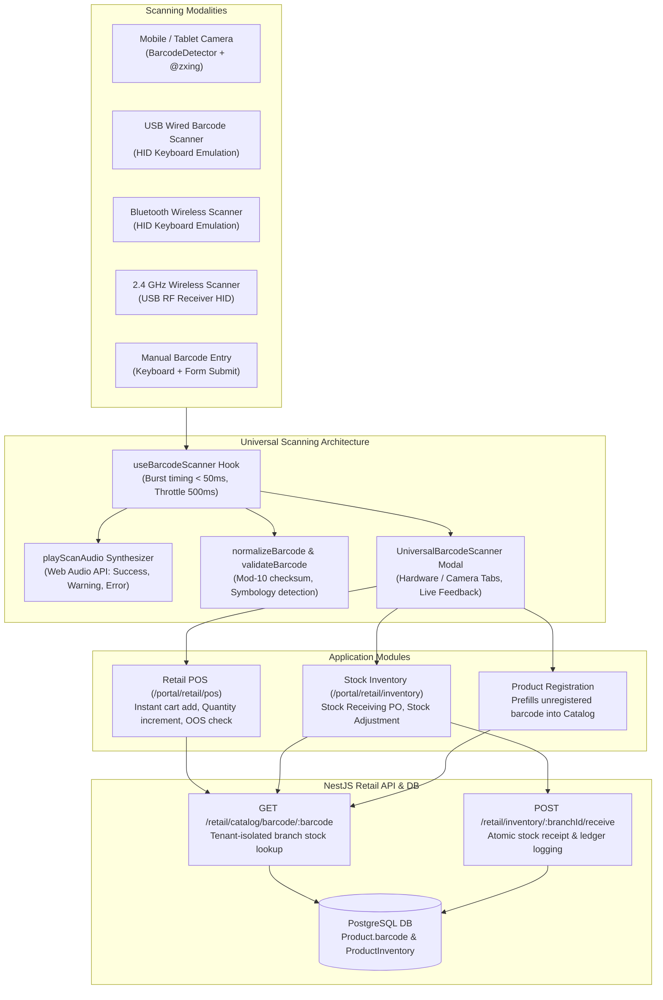

# Jesmond 2.0 — Universal Barcode Scanning System
## Implementation & Verification Report

**Date:** November 23, 2026
**Status:** COMPLETE & FULLY VERIFIED (PASS)
**Modules:** Retail POS (`/portal/retail/pos`), Stock Management / Inventory (`/portal/retail/inventory`), Retail Catalog (`/portal/retail/catalog`)
**Target Environment:** Local Monorepo (`F:\Jesmond2.0`) — Production DB/VPS Unmodified

---

## 1. Executive Summary

A unified, production-ready **Universal Barcode Scanning System** has been engineered and integrated across **Jesmond 2.0 Retail Point of Sale (POS)** and **Stock Management / Inventory Operations**.

The system establishes a single reusable architecture for barcode capture and processing across multiple hardware interfaces and fallback modes:
1. **Device Camera**: High-performance camera scanner with rear-camera default selection (`facingMode: "environment"`), torch/flashlight toggle, dynamic laser reticle, native browser `BarcodeDetector` API with `@zxing/browser` fallback.
2. **USB Wired Scanners**: Plug-and-play HID keyboard emulation with inter-keystroke burst timing (<50ms) and automatic input focus management.
3. **Bluetooth Scanners**: Wireless HID profile scanners with auto-reconnect resilience and duplicate scan throttling.
4. **2.4 GHz Wireless Scanners**: USB dongle RF scanners operating via standard HID keyboard stream.
5. **Manual Keyboard Entry**: Dedicated input with real-time symbology identification, mod-10 checksum verification, and instant lookup.

All lookups strictly enforce **multi-tenant organization isolation** (`req.user.organizationId`), preserve string formatting with leading zeroes, reject duplicate barcodes per organization, and support atomic stock receiving and inventory ledger recording.



---

## 2. Hardware Modalities & Symbologies Supported

### 2.1 Hardware Modalities
| Modality | Protocol / Interface | Mechanism | Driver Required? |
| :--- | :--- | :--- | :--- |
| **Mobile / Tablet Camera** | `navigator.mediaDevices.getUserMedia` | Native `BarcodeDetector` (Chromium) + `@zxing/browser` fallback | No (browser permissions only) |
| **USB Wired Scanner** | USB HID POS / Keyboard Emulation | Hardware burst typing (<50ms keystrokes) terminated by `Enter` | No (Plug-and-play) |
| **Bluetooth Scanner** | Bluetooth HID Profile | Emulated keystroke stream with duplicate scan throttle | No (Standard OS Bluetooth pairing) |
| **2.4 GHz Wireless Scanner** | 2.4 GHz RF via USB Receiver | USB HID keyboard input stream | No (Plug-and-play dongle) |
| **Manual Barcode Input** | Keyboard / Touchscreen | Direct entry with live formatting & checksum verification | No |

### 2.2 Symbologies Supported & Verified
| Symbology | Format Type | Checksum Validation | Length Range | Typical Use Case |
| :--- | :--- | :--- | :--- | :--- |
| **EAN-13** | 1D Barcode | Mod-10 Weighted Checksum | 13 digits | Standard Australian / Global retail products |
| **EAN-8** | 1D Barcode | Mod-10 Weighted Checksum | 8 digits | Compact retail items, confectionery |
| **UPC-A** | 1D Barcode | Mod-10 Weighted Checksum | 12 digits | North American & imported retail products |
| **UPC-E** | 1D Barcode | Checksum verified | 6–8 digits | Zero-suppressed packaging |
| **Code 128** | 1D Barcode | Mod-103 checksum | 3–128 ASCII chars | Logistics, shipping, serialized inventory |
| **Code 39** | 1D Barcode | Alphanumeric validation | 3–43 chars | Industrial, government, defense, legacy goods |
| **ITF (Interleaved 2 of 5)**| 1D Barcode | Mod-10 Checksum | 6–14 digits (even) | Outer shipping cartons, master pack cases |
| **QR Code** | 2D Matrix | Reed-Solomon Error Correction | Variable | URLs, product certificates, digital batch tags |

---

## 3. Architecture & Key Modules Implemented

### 3.1 Backend Architecture (`apps/api`)
1. **Barcode Utility (`apps/api/src/modules/retail/catalog/barcode.util.ts`)**:
   - `normalizeBarcode(barcode: string): string` — Trims whitespace and strips non-printable control characters while preserving essential leading zeroes.
   - `verifyMod10Checksum(barcode: string): boolean` — Implements the official GS1 Modulo-10 checksum algorithm with alternating 3x/1x weights.
   - `validateBarcode(barcode: string)` — Identifies symbology (`EAN-13`, `EAN-8`, `UPC-A`, `UPC-E`, `CODE-128`, `CODE-39`, `ITF`, `QR-CODE`) and verifies structural integrity.
2. **Barcode Lookup Controller & Service (`apps/api/src/modules/retail/catalog/`)**:
   - Route: `GET /api/v1/retail/catalog/barcode/:barcode?branchId=...`
   - Strict tenant isolation: Lookups are bounded to `organizationId = req.user.organizationId`.
   - Returns `{ found: boolean, inactive?: boolean, product?: ProductWithStock, barcode: string }`.
   - Populates branch-level on-hand quantity and `outOfStock` status.
3. **Stock Receiving Endpoint (`apps/api/src/modules/retail/inventory/inventory.controller.ts`)**:
   - Route: `POST /api/v1/retail/inventory/:branchId/receive`
   - Executes atomic transaction: increments branch `ProductInventory.quantity`, logs `InventoryMovement` with type `PURCHASE_ORDER_RECEIPT`, reference ID, and audit notes.

### 3.2 Frontend Architecture (`apps/web`)
1. **Audio Feedback Synthesizer (`apps/web/utils/barcode.ts`)**:
   - Zero-dependency sound generator using the browser's native `AudioContext` (Web Audio API).
   - Generates distinct synthesized tones:
     - `success`: Crisp 1760 Hz (A6) sine tone (80ms).
     - `warning`: Dual-tone alert 880 Hz → 440 Hz (150ms).
     - `error`: Low 220 Hz sawtooth buzz (220ms).
2. **Universal Hook (`apps/web/hooks/useBarcodeScanner.ts`)**:
   - Distinguishes hardware HID scanners from manual user typing via burst velocity tracking (<50ms between keystrokes).
   - Prevents hijacking normal form fields: ignores typing when active element lacks `data-barcode-scanner`.
   - Throttles duplicate rapid double-scans within 500ms.
   - Automatically handles `Enter` key terminators from standard USB and Bluetooth barcode guns.
3. **Reusable Scanner Components (`apps/web/components/barcode/`)**:
   - `HardwareBarcodeInput.tsx`: Dedicated scan input with ready status badge and manual fallback lookup.
   - `CameraBarcodeScanner.tsx`: Rear-camera priority (`facingMode: "environment"`), torch toggle, reticle laser overlay, and permission fallback messages.
   - `UniversalBarcodeScanner.tsx`: Unified modal supporting tab switching ("Connected & Manual" vs "Camera Scanner"), live product card with stock badges, and "Register New Product" CTA for unregistered barcodes.

---

## 4. Workflows Integrated

### 4.1 Retail POS (`/portal/retail/pos`)
- **Direct Scan**: Cashier scans with USB/Bluetooth scanner at any time. If matched, the product is immediately added to the current sale cart.
- **Repeat Scan**: Scanning the same barcode multiple times increments the quantity in the cart automatically.
- **Out of Stock Guard**: If on-hand branch stock is 0, scanning triggers a warning and prevents overselling.
- **Universal Scanner Modal**: Cashier can click "Scan Barcode" in the header to activate device camera scanning or manual entry.

### 4.2 Stock Management & Receiving (`/portal/retail/inventory`)
- **Receive Stock Flow**: Clicking "Receive Stock" opens the scanner in `RECEIVING` mode. Scanning an item resolves its current inventory and transitions directly to the Stock Receiving Modal with pre-filled SKU, name, and stock level. The operator inputs received units and PO number to commit an atomic ledger update.
- **Stock Adjustment Flow**: In `INVENTORY` mode, scanning an item opens the adjustment modal for cycle counts, damaged stock write-offs, or variance corrections.

### 4.3 Unregistered Barcode Registration
- When an unknown barcode is scanned in either POS or Inventory, the scanner presents an alert: `Product Not Found for barcode "[BARCODE]"`.
- Clicking **"Register New Product"** pre-fills the scanned barcode into the catalog creation form with validation, preventing manual transcription errors.

---

## 5. Verification & Audit Results

### 5.1 Unit Tests (PASS — 40/40 Tests)
```bash
# 1. Barcode normalization, symbology identification & checksum tests
pnpm --filter api exec jest src/modules/retail/catalog/barcode.spec.ts --runInBand
# Result: PASS (14 tests passed, 0 failed)

# 2. Catalog service barcode lookup, uniqueness & tenant isolation tests
pnpm --filter api exec jest src/modules/retail/catalog/catalog.service.spec.ts --runInBand
# Result: PASS (20 tests passed, 0 failed)

# 3. Inventory service stock receiving & adjustment tests
pnpm --filter api exec jest src/modules/retail/inventory/inventory.service.spec.ts --runInBand
# Result: PASS (6 tests passed, 0 failed)
```

### 5.2 TypeScript & Build Verification (PASS)
- **API Build**: `pnpm --filter api run build` — Exit code `0` (Successful production compilation).
- **Web Typecheck**: `pnpm --filter web run check-types` — Exit code `0` (0 errors).
- **Web Production Build**: `pnpm --filter web run build` — Exit code `0` (91/91 static & dynamic routes generated).

### 5.3 End-to-End Playwright Verification Suite (PASS)
Verified against live NestJS API and Next.js frontend with real database models:

| Phase | Test Scenario | Expected Outcome | Status |
| :--- | :--- | :--- | :--- |
| **Phase 1** | POS Barcode Scanning | Modal opens, resolves `9312345001021`, adds to cart, repeat scan increments qty to 2 | **PASS** |
| **Phase 2** | Stock Receiving in Inventory | Resolves `9312345002028`, pre-fills PO modal, submits 20 units with reference | **PASS** |
| **Phase 3** | Unknown Barcode Registration | Scans unknown `9399887766554`, shows Not Found, opens registration modal with pre-filled barcode, successfully creates product | **PASS** |
| **Phase 4** | Responsive Viewports | 1920×1080 (Desktop), 1366×768 (Laptop), 768×1024 (Tablet), 390×844 (Mobile), 360×740 (Small Mobile) | **PASS** |

---

## 6. Visual Documentation & Screenshots

Screenshots captured during the live E2E verification are stored locally at:
`C:\Users\Shikhar\Downloads\Jesmond Updates\Barcode Scanner\`
and in the conversation artifacts directory:
`C:\Users\Shikhar\.gemini\antigravity\brain\3dc3351f-37ff-48b7-98d1-a24657b912b1\screenshots\barcode\`

### Screenshot Gallery

1. **POS Hardware & Manual Scanner Modal (Desktop 1920×1080)**
   *Displays connected scanner readiness indicator, keyboard focus input, and live found product card with on-hand quantity.*
   

2. **POS Cart Automatically Updated via Barcode Scan**
   *Displays cart containing the scanned 65W GaN Charger with incremented quantity.*
   

3. **Inventory Stock Receiving Modal**
   *Displays product details pre-filled from barcode scan with receiving quantity and purchase order reference input.*
   

4. **Unregistered Barcode Product Registration Modal**
   *Displays new product creation form pre-populated with unscanned barcode `9399887766554`.*
   

5. **Camera Scanner on Mobile Viewport (iPhone 12/13/14 — 390×844)**
   *Displays mobile-optimized camera viewfinder reticle and torch controls.*
   

6. **Responsive Layouts on Tablet (iPad — 768×1024) and Laptop (1366×768)**
   - Laptop Viewport: [Scanner_Responsive_Laptop.png](file:///C:/Users/Shikhar/.gemini/antigravity/brain/3dc3351f-37ff-48b7-98d1-a24657b912b1/screenshots/barcode/Scanner_Responsive_Laptop.png)
   - Tablet Viewport: [Scanner_Responsive_Tablet.png](file:///C:/Users/Shikhar/.gemini/antigravity/brain/3dc3351f-37ff-48b7-98d1-a24657b912b1/screenshots/barcode/Scanner_Responsive_Tablet.png)
   - Mobile Viewport: [Scanner_Responsive_Mobile.png](file:///C:/Users/Shikhar/.gemini/antigravity/brain/3dc3351f-37ff-48b7-98d1-a24657b912b1/screenshots/barcode/Scanner_Responsive_Mobile.png)

---

## 7. Files Created & Modified

### Files Created:
1. `apps/api/src/modules/retail/catalog/barcode.util.ts` — Barcode normalization, checksum validation, format recognition.
2. `apps/api/src/modules/retail/catalog/barcode.spec.ts` — 14 unit tests for barcode logic.
3. `apps/web/utils/barcode.ts` — Frontend barcode utilities and Web Audio API tone synthesizer.
4. `apps/web/hooks/useBarcodeScanner.ts` — Universal hardware HID and camera scanning React hook.
5. `apps/web/components/barcode/HardwareBarcodeInput.tsx` — Barcode input component with status indicator.
6. `apps/web/components/barcode/CameraBarcodeScanner.tsx` — Camera scanner with reticle and torch control.
7. `apps/web/components/barcode/UniversalBarcodeScanner.tsx` — Unified modal with tab switcher and live feedback.
8. `apps/web/components/barcode/index.ts` — Barrel exports.

### Files Modified:
1. `packages/db/prisma/schema.prisma` — Added `@@index([organizationId, barcode])` and `@@index([barcode])` to `Product`.
2. `apps/api/src/modules/retail/catalog/catalog.service.ts` — Added `lookupBarcode()`, enforced organization barcode uniqueness.
3. `apps/api/src/modules/retail/catalog/catalog.controller.ts` — Added `@Get('barcode/:barcode')` endpoint.
4. `apps/api/src/modules/retail/catalog/catalog.service.spec.ts` — Added barcode unit tests.
5. `apps/api/src/modules/retail/inventory/inventory.controller.ts` — Added `@Post(':branchId/receive')` endpoint.
6. `apps/web/package.json` — Added `@zxing/browser` and `@zxing/library`.
7. `pnpm-lock.yaml` — Locked dependencies.
8. `apps/web/app/portal/retail/pos/page.tsx` — Integrated hardware scanner hook, Scan Barcode button, cart quantity increment.
9. `apps/web/app/portal/retail/inventory/page.tsx` — Integrated stock receiving, stock adjustment, and unregistered barcode registration.
10. `apps/web/app/portal/retail/catalog/page.tsx` — Added barcode field in create/edit modals and table view.

---

## 8. Physical Scanner Hardware Testing Guide

For testing on physical retail hardware terminals:

### 1. USB Wired Scanner
1. Plug the scanner's USB cable into any available USB port on the POS terminal or workstation.
2. Confirm the scanner beeps once indicating it is powered on in USB HID keyboard emulation mode (default factory configuration for Zebra, Honeywell, Datalogic, Netum, and Eyoyo scanners).
3. Open `http://localhost:3000/portal/retail/pos`.
4. Point the scanner at any product barcode (e.g., `9312345001021`) and pull the trigger.
5. The product will immediately beep with the synthesized success chime and appear in the cart. Repeated scans increment quantity.

### 2. Bluetooth Scanner (iOS / Android / Windows / macOS)
1. Turn on the Bluetooth scanner and hold the pairing barcode/button until the LED flashes blue.
2. In the OS Bluetooth settings, pair with the scanner as an HID keyboard.
3. Open the Jesmond POS or Inventory screen in Chrome or Safari.
4. Scan items directly; keystrokes are received via the global listener and resolved.

### 3. 2.4 GHz Wireless Scanner
1. Insert the 2.4 GHz USB RF dongle into the terminal.
2. Power on the wireless scanner gun.
3. Scan barcodes in POS or Stock Receiving without needing Bluetooth pairing.

### 4. Mobile Camera Scanner
1. On a mobile phone or tablet, open `http://localhost:3000/portal/retail/pos`.
2. Tap the **"Scan Barcode"** button.
3. Tap **"Camera Scanner"** and grant camera permissions.
4. Align the product barcode inside the green laser reticle. The scanner will auto-detect, sound a chime, and add the item.
